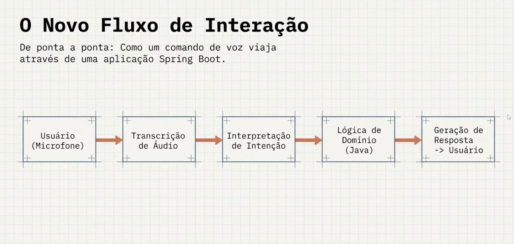
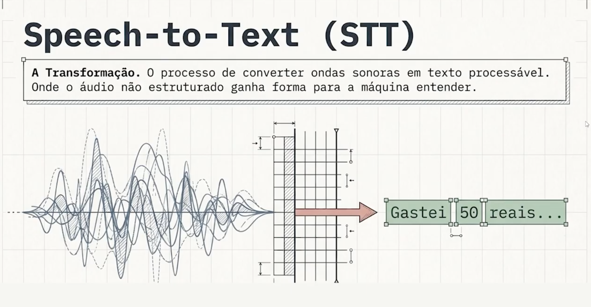
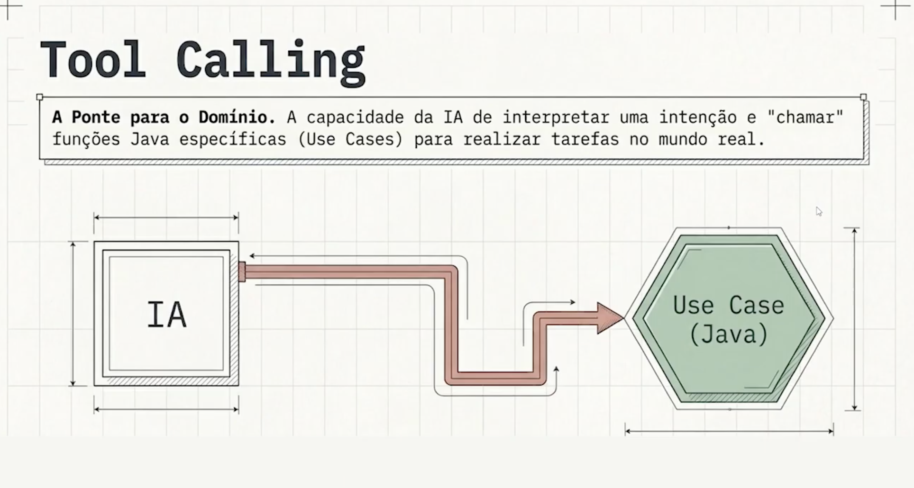
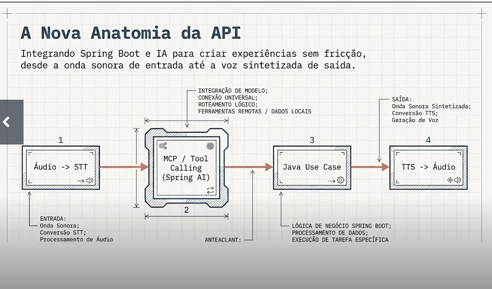
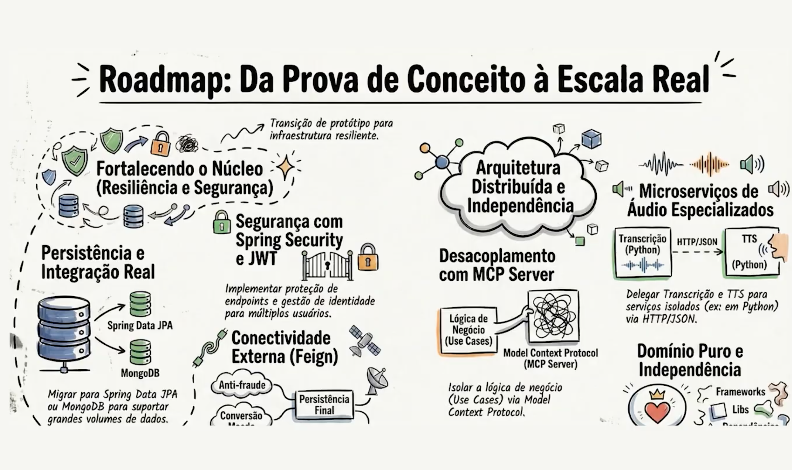

# 🎙️ Spring AI Budget Assistant (BudgetinAI)

> **Assistente financeiro inteligente que transforma comandos de voz naturais em transações financeiras estruturadas, utilizando Spring AI, OpenAI e Arquitetura Limpa.**

[](https://openjdk.org/)
[](https://spring.io/projects/spring-boot)
[](https://spring.io/projects/spring-ai)
[](https://ollama.ai)
[](https://github.com/digitalinnovationone/dio-spring-boot-learning-track/blob/main/05-spring-ai/README.md)
[](https://gradle.org)
[](https://www.docker.com/)

---

## 💡 Visão Geral

O **BudgetinAI** elimina a fricção da digitação manual de despesas. Em vez de preencher formulários com datas, categorias e valores, o usuário apenas envia um áudio (ex: *"Gastei 50 reais no mercado"* ou *"Abasteci 120 reais no posto"*).

O sistema processa a fala com modelos de ponta, compreende a intenção através de **Tool Calling**, persiste os dados de forma estruturada e responde em texto ou áudio sintetizado.

<p align="center">
  
</p>

---

## 🚀 A Evolução das Interfaces

Interfaces clássicas dependem de formulários estáticos e validações rígidas de JSON. A nova era de APIs com IA traz interfaces flexíveis, tolerantes e guiadas por intenção de voz:

| Padrão Clássico (CRUD) | Nova Era com IA (BudgetinAI) |
| :--- | :--- |
| Entrada manual de campos | Entrada por voz em linguagem natural |
| JSON estático e rígido | Extração semântica com Whisper + LLM |
| Múltiplos cliques no app | Registro instantâneo por comando de voz |
| Resposta puramente textual | Resposta multimodal (JSON, Texto ou Áudio TTS) |

<p align="center">
  
</p>

---

## 🔄 Fluxo de Interação de Ponta a Ponta

<p align="center">
  
</p>

1. **Entrada de Áudio:** O usuário envia uma mensagem de voz (`.m4a`, `.mp3`, `.wav`).
2. **Speech-to-Text (STT):** O modelo **Whisper** da OpenAI transcreve o áudio em texto em português.
3. **Compreensão e Tool Calling:** O **GPT-4o-mini** analisa a frase, identifica o valor, descrição e categoria (`GROCERIES`, `PHARMA`, `AUTO`), e invoca automaticamente a ferramenta (`Tool`) de persistência.
4. **Persistência de Negócio:** O caso de uso de aplicação executa a validação e grava a transação no MySQL.
5. **Text-to-Speech (TTS):** Opcionalmente, a resposta é sintetizada em áudio para retorno ao usuário.

<div align="center">
  
  
</div>

---

## 🏛️ Arquitetura do Projeto (Clean Architecture)

O projeto é organizado por **Domínios/Contextos Delimitados (Package by Feature)**, garantindo que regras de negócio não fiquem acopladas aos frameworks ou provedores de IA:

```text
src/main/java/org/rogeriocs/budgetinai/
├── BudgetinAiApplication.java
│
├── transaction/                              # Domínio: Gestão Financeira
│   ├── domain/                               # Entidades e regras puras
│   │   ├── Transaction.java
│   │   ├── TransactionId.java
│   │   ├── Category.java
│   │   └── TransactionRepository.java        (Porta de Saída)
│   ├── application/                          # Casos de uso
│   │   ├── PersistTransactionUseCase.java
│   │   ├── ListTransactionsByCategoryUseCase.java
│   │   ├── input/PersistTransactionInput.java
│   │   └── output/TransactionOutput.java
│   └── infrastructure/                       # Adaptadores JPA e HTTP
│       ├── http/ (TransactionController, DTOs de Request/Response)
│       └── persistence/ (TransactionEntity, JpaTransactionRepository)
│
└── assistant/                                # Domínio: Assistente de Inteligência Artificial
    ├── domain/                               # Portas puras (independente de IA específica)
    │   ├── AudioTranscriber.java
    │   ├── FinancialAssistant.java
    │   ├── VoiceSynthesizer.java
    │   └── ChatAssistant.java
    ├── application/                          # Casos de uso de orquestração
    │   ├── ProcessVoiceTransactionTextUseCase.java
    │   ├── ProcessVoiceTransactionAudioUseCase.java
    │   ├── TranscribeAudioUseCase.java
    │   ├── SynthesizeVoiceUseCase.java
    │   └── ChatUseCase.java
    └── infrastructure/                       # Adaptadores de Framework
        ├── springai/                         # Spring AI / OpenAI
        │   ├── TransactionTools.java         # Anotações @Tool isoladas
        │   ├── SpringAiAudioTranscriber.java
        │   ├── SpringAiFinancialAssistant.java
        │   └── SpringAiVoiceSynthesizer.java
        └── http/                             # Controllers REST
            ├── TransactionAssistantController.java
            ├── ChatController.java
            ├── TranscriptionController.java
            └── TextToSpeechController.java
```

<p align="center">
  
</p>

---

## 📡 Endpoints da API

### Assistente de Voz & Transações
| Método | Endpoint | Descrição | Consome | Retorna |
| :--- | :--- | :--- | :--- | :--- |
| `POST` | `/transactions/ai/text` | Processa áudio, grava a transação e responde em texto | `multipart/form-data` | `text/plain` |
| `POST` | `/transactions/ai/audio` | Processa áudio, grava a transação e responde em áudio | `multipart/form-data` | `audio/mp3` |
| `POST` | `/transactions` | Criação manual de transação financeira | `application/json` | `TransactionResponse` |
| `GET` | `/transactions/{category}` | Lista transações por categoria (`GROCERIES`, `PHARMA`, `AUTO`) | - | `List<TransactionResponse>` |

### Serviços Básicos de IA
| Método | Endpoint | Descrição |
| :--- | :--- | :--- |
| `POST` | `/api/transcribe` | Transcreve arquivo de áudio para texto |
| `POST` | `/api/synthesize` | Sintetiza texto enviado em arquivo de áudio MP3 |
| `GET` | `/api/chat` | Chat interativo simples com o assistente via query param `?prompts=` |
| `GET` | `/api/chat-model` | Chamada direta ao modelo de chat |

---

## 🛠️ Tecnologias Utilizadas

* **Linguagem:** Java 25 (OpenJDK Temurin)
* **Framework:** Spring Boot & Spring Data JPA
* **Framework de IA:** Spring AI (OpenAI Starter, Ollama Starter & Tools API)
* **Modelos de IA Suportados:**
  * **Nuvem (OpenAI):**
    * Whisper (`whisper-1`) — Transcrição de áudio
    * GPT-4o-mini — Raciocínio, extração e Tool Calling
    * TTS (`gpt-4o-mini-tts` / `tts-1`) — Síntese de voz
  * **Local (Ollama):**
    * Llama 3 (`llama3:latest` ou `llama3.2`) — Execução 100% local e gratuita com Tool Calling
* **Banco de Dados:** MySQL 8 em container Docker
* **Build & Testes:** Gradle (Kotlin DSL), JUnit 5, Mockito e AssertJ

---

## 🚀 Como Executar Localmente

### 1. Pré-requisitos
* **Java 25** instalado (ex: via SDKMAN: `sdk install java 25-tem`)
* **Docker** e **Docker Compose**
* Uma chave de API da **OpenAI**

### 2. Configuração de Provedores de IA (Arquitetura Híbrida)

No arquivo `application.properties`, você pode desacoplar e escolher independentemente os provedores de **LLM**, **STT** e **TTS**:

```properties
# Arquitetura Híbrida (Mix & Match)
app.ai.provider.llm=ollama     # 'ollama' (local) ou 'openai' (nuvem)
app.ai.provider.stt=openai     # 'openai' (Whisper) ou 'none'
app.ai.provider.tts=openai     # 'openai' (TTS) ou 'none'
```

#### 💡 Por que uma Arquitetura Híbrida?
1. **Privacidade e Custo Zero no Raciocínio (LLM):** Transações financeiras, valores e categorias são processados pelo **Llama 3 local no Ollama**, garantindo que seus dados financeiros nunca saiam da sua infraestrutura e zerando custos com tokens de chat.
2. **Alta Fidelidade no Áudio (STT & TTS):** Modelos de voz (Whisper e TTS da OpenAI) oferecem precisão fonética impecável em português com custos de apenas frações de centavo por requisição.
3. **Liberdade Arquitetural:** Se no futuro quiser plugar um transcritor local (`whisper.cpp`) ou sintetizador open-source (`piper`), basta criar o adapter sem alterar nenhuma regra de negócio.

### 3. Iniciar o Banco de Dados (MySQL)
```bash
docker compose up -d
```
*(O banco subirá na porta mapeada `3307:3306`)*.

### 4. Executar a Aplicação
Exportando as variáveis do `.env` no terminal:
```bash
export $(grep -v '^#' .env | xargs) && ./gradlew bootRun
```
*(Ou abra o projeto na sua IDE favorita — Antigravity / IntelliJ — e execute o `main` da classe `BudgetinAiApplication`)*.

### 5. Executar a Suíte de Testes
```bash
./gradlew test
```

---

## 🗺️ Roadmap: Da Prova de Conceito à Escala Real

<p align="center">
  
</p>

- [x] Estruturação com Clean Architecture modular por domínios
- [x] Transcrição com Whisper e Tool Calling com Spring AI
- [x] Persistência em banco relacional (MySQL)
- [x] Resposta com síntese de voz (TTS)
- [x] Suíte de testes unitários isolados com Mockito
- [x] Suporte a LLM local gratuito com Ollama (Llama 3)
- [ ] Suporte a múltiplos provedores em nuvem (Claude / Gemini)
- [ ] Processamento assíncrono de áudio com mensageria (Kafka / RabbitMQ)
- [ ] Relatórios e dashboards de gastos por período e categoria

---

## 📚 Referência & Agradecimentos

Este projeto foi desenvolvido com base no bootcamp da **Digital Innovation One (DIO)**:
* **Repositório de Referência:** [DIO Spring Boot Learning Track - Módulo 05: Spring AI](https://github.com/digitalinnovationone/dio-spring-boot-learning-track/blob/main/05-spring-ai/README.md)
* **Instrutor/Trilha:** Desenvolvimento de assistentes inteligentes utilizando o ecossistema Spring Boot e modelos generativos da OpenAI.

---

## 📄 Licença

Este projeto é desenvolvido para fins de estudo e aprimoramento em arquitetura de software e inteligência artificial aplicada.
